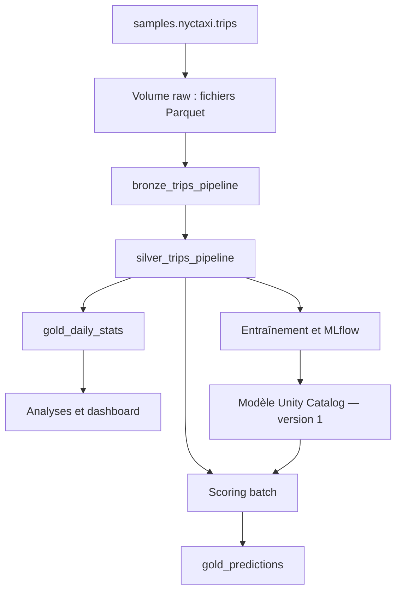
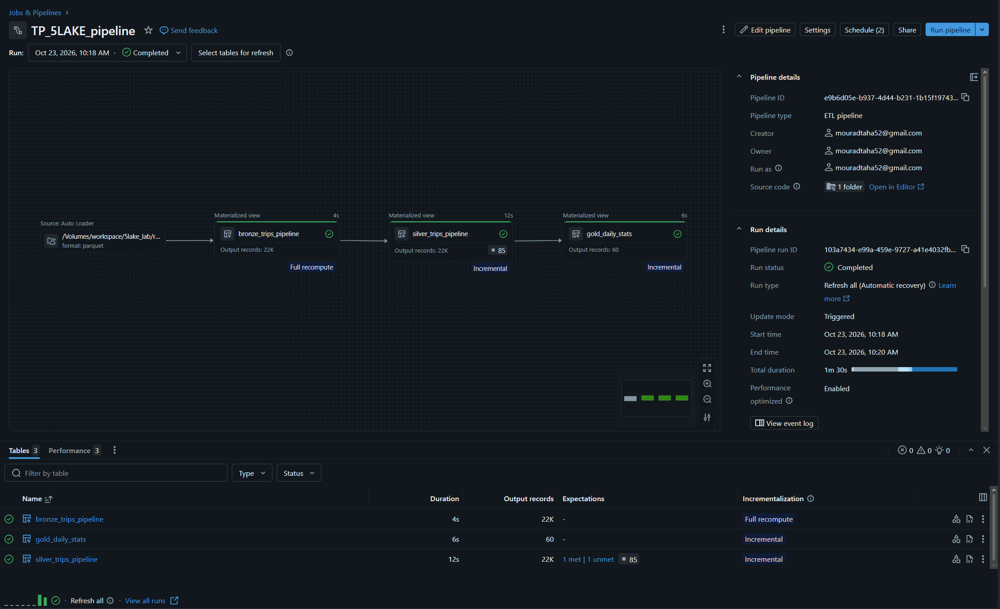
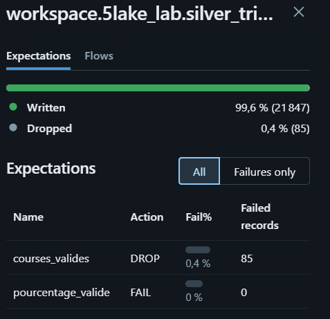
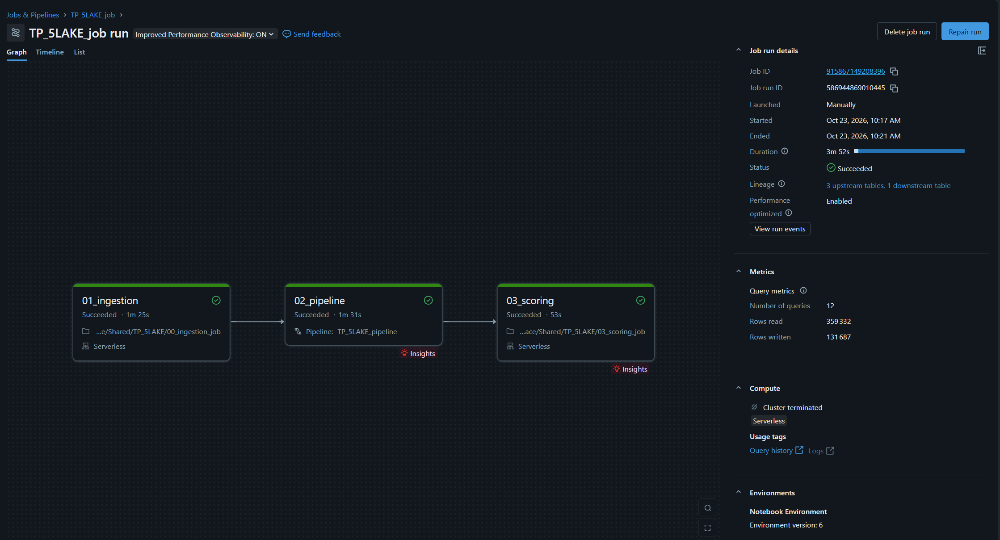
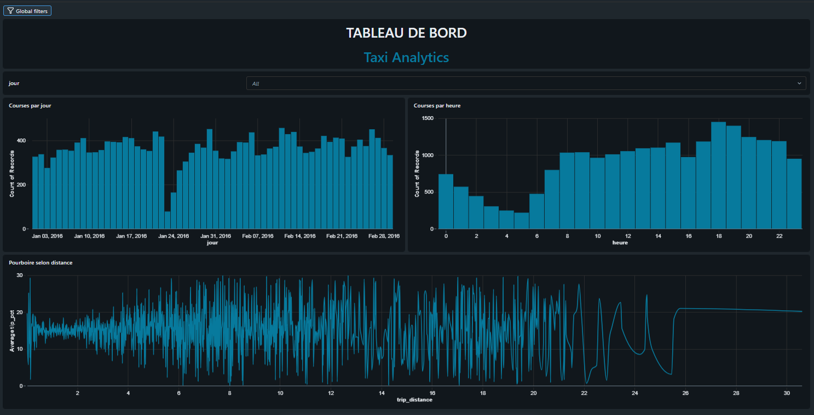
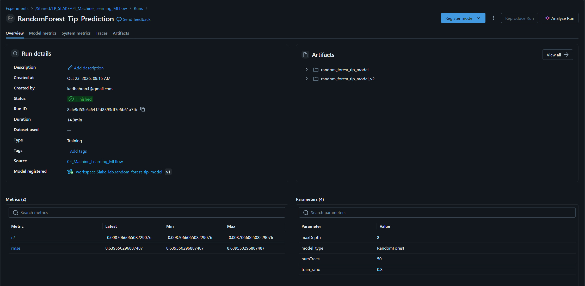
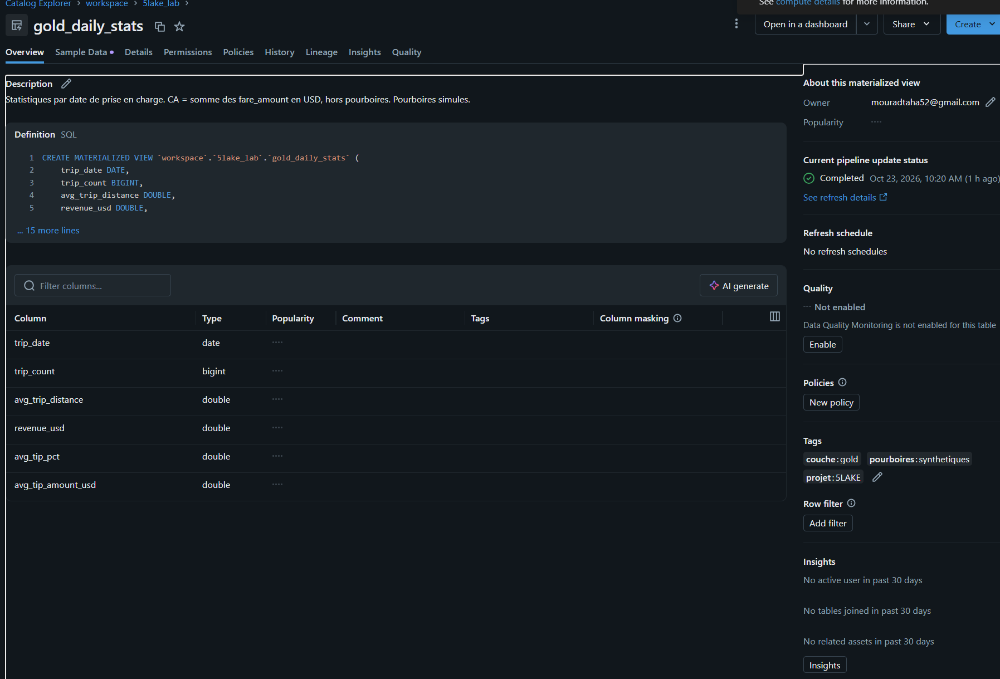
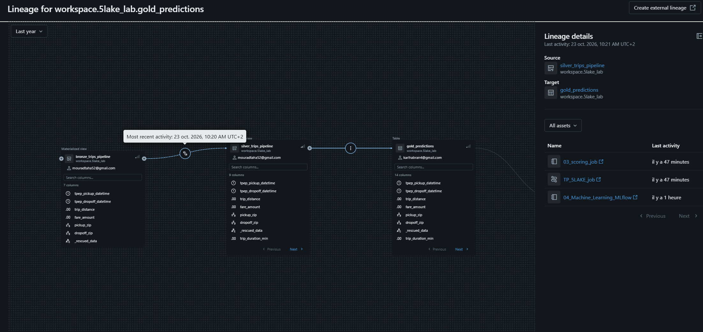

# NYC Taxi — Pipeline de données, analytique et prédiction des pourboires

**SUPINFO · 5LAKE — Data Engineering · TP Databricks**  

**Groupe :** Félix — Taha — Karl  

**Environnement :** Databricks Free Edition, calcul serverless, Unity Catalog

## 1. Contexte et objectifs

Dans le rôle d’une équipe de data engineers pour une société de VTC, nous avons construit une chaîne allant des courses brutes à leur analyse et à une prédiction batch du pourcentage de pourboire.

Le projet couvre l’ingestion de fichiers, le stockage Delta Lake, le nettoyage, les contrôles qualité, les agrégations, l’orchestration, la BI, le Machine Learning et la gouvernance.

### Répartition du travail

| Membre | Responsabilités |
|---|---|
| Félix | Ingestion, exploration, tables Delta Bronze/Silver, MERGE et Time Travel — parties 1 et 2 |
| Taha | Pipeline Lakeflow, expectations, Job et gouvernance — parties 3, 4 et 7 |
| Karl | Analyses SQL, dashboard, Genie, modèle, MLflow et scoring — parties 5 et 6 |

## 2. Données et limites du projet

La source est `samples.nyctaxi.trips`. Le sujet demande un échantillon d’environ 300 000 lignes ; la table accessible dans notre environnement contient **21 932 lignes**. Nous utilisons toutes les lignes disponibles, sans créer de doublons pour atteindre artificiellement le volume demandé. Le paramètre d’ingestion `sample_size = 300000` constitue un plafond.

| Colonne source | Type | Description |
|---|---|---|
| `tpep_pickup_datetime` | Timestamp | Début de la course |
| `tpep_dropoff_datetime` | Timestamp | Fin de la course |
| `trip_distance` | Double | Distance de la course, en miles |
| `fare_amount` | Double | Tarif de la course, en USD |
| `pickup_zip` | Integer | Code postal de départ |
| `dropoff_zip` | Integer | Code postal d’arrivée |

**Pourboires synthétiques.** La source ne contient pas de montant de pourboire. `tip_pct` est donc simulé entre 0 et 30, où `15` signifie 15 %. Félix utilise un tirage avec graine dans son notebook de démonstration ; le pipeline utilise une valeur reproductible issue d’un hash des caractéristiques de la course. Ces valeurs peuvent différer entre les deux tables Silver.

Le modèle, le scoring et les questions Genie utilisent **`silver_trips_pipeline`**. La simulation ne représente pas un comportement réel des clients : les performances ML démontrent le fonctionnement technique de la chaîne, pas une capacité prédictive métier validée. Cette adaptation constitue une limite du projet par rapport à une étude sur des pourboires réels.

## 3. Architecture et objets



| Objet | Emplacement ou nom |
|---|---|
| Catalogue | `workspace` |
| Schéma | `workspace.5lake_lab` |
| Volume | `workspace.5lake_lab.raw` |
| Fichiers bruts | `/Volumes/workspace/5lake_lab/raw/nyc_trips/` |
| Tables de démonstration Delta | `workspace.5lake_lab.bronze_trips`, `workspace.5lake_lab.silver_trips` |
| Sorties Bronze/Silver du pipeline | `workspace.5lake_lab.bronze_trips_pipeline`, `workspace.5lake_lab.silver_trips_pipeline` |
| Statistiques quotidiennes | `workspace.5lake_lab.gold_daily_stats` |
| Prédictions | `workspace.5lake_lab.gold_predictions` |
| Modèle enregistré | `workspace.5lake_lab.random_forest_tip_model`, version `1` |
| Pipeline / Job | `TP_5LAKE_pipeline` / `TP_5LAKE_job` |

Les couches du pipeline sont matérialisées avec `CREATE OR REFRESH MATERIALIZED VIEW`. Les noms distincts évitent les conflits avec les tables Delta utilisées pour le MERGE de démonstration. Le pipeline relit les fichiers bruts : les corrections appliquées à `silver_trips` ne sont pas automatiquement propagées à `silver_trips_pipeline`.

## 4. Ingestion, exploration et Delta Lake — parties 1 et 2

Les courses sont exportées en Parquet dans le Volume `raw`, puis relues pour vérifier le nombre de lignes. L’exploration porte sur le schéma, les valeurs nulles et les distributions de `trip_distance` et `fare_amount`.

`bronze_trips` conserve les données brutes. `silver_trips` applique la déduplication et exclut les distances ou tarifs non positifs ainsi que les courses dont la fin précède le début. La durée est calculée par différence des timestamps, divisée par 60 pour obtenir des minutes. Un pourcentage de pourboire synthétique est ajouté.

Trente corrections fictives augmentant certains tarifs de 10 % sont ensuite appliquées avec un MERGE. La correspondance utilise les timestamps et les codes postaux ; l’unicité de cette clé composée est contrôlée dans le notebook. L’historique et le Time Travel permettent de comparer les états avant et après correction.

### Question 1 — Que montre l’historique ? Pourquoi Delta plutôt que Parquet simple ?

`DESCRIBE HISTORY` présente les versions de la table, les dates, les opérations et leurs métriques. Dans l’exécution documentée par Félix, les versions précédentes correspondent à la création ou aux reconstructions de Silver, puis la version 3 à un MERGE ; la version 2 est consultée comme état avant correction. Ces numéros correspondent à cette exécution ; ils peuvent évoluer lors des relances.

Delta ajoute un journal de transactions aux fichiers Parquet. Il apporte les transactions ACID, le contrôle de schéma, les mises à jour avec MERGE, l’historique et la lecture d’anciens états. Ces fonctions facilitent la correction et la traçabilité des courses. Des fichiers Parquet seuls n’offrent pas cette gestion transactionnelle. Le Time Travel reste soumis à la conservation des fichiers et du journal nécessaires.

## 5. Pipeline déclaratif et qualité — partie 3

Le pipeline batch lit les fichiers Parquet dans Bronze, reconstruit Silver puis agrège Gold. Databricks déduit l’ordre de traitement à partir des dépendances déclarées.

| Expectation sur Silver | Condition | Action |
|---|---|---|
| `courses_valides` | Distance et tarif non nuls et > 0 ; dates présentes ; fin ≥ début | `DROP ROW` |
| `pourcentage_valide` | `tip_pct` non nul et compris entre 0 et 30 | `FAIL UPDATE` |

La déduplication intervient avant les expectations. Les lignes invalides sont soumises au contrôle, sans filtre préalable qui masquerait leurs rejets. Le contrôle du pourcentage vérifie surtout la cohérence du calcul synthétique : il ne prouve pas la qualité d’un pourboire réellement observé.

### Résultats observés

| Indicateur | Valeur |
|---|---:|
| Courses brutes | 21 932 |
| Courses écrites dans Silver | 21 847 |
| Courses rejetées par `courses_valides` | 85 |
| Taux de rejet affiché | Environ 0,4 % |
| Jours agrégés dans Gold | 60 |

`gold_daily_stats` regroupe les courses selon leur date de prise en charge :

| Colonne | Définition |
|---|---|
| `trip_date` | Date de prise en charge |
| `trip_count` | Nombre de courses valides |
| `avg_trip_distance` | Distance moyenne en miles |
| `revenue_usd` | Somme de `fare_amount`, hors pourboires ; ce n’est pas nécessairement le montant total facturé |
| `avg_tip_pct` | Moyenne des pourcentages synthétiques, non pondérée par le tarif |
| `avg_tip_amount_usd` | Moyenne de `fare_amount × tip_pct / 100` |

### Question 2 — Combien de rejets ? Quelle règle serait critique en FAIL UPDATE ?

L’expectation `courses_valides` a rejeté **85 lignes**, soit environ **0,4 %** des lignes contrôlées. Les **21 847** courses restantes ont été écrites dans Silver. L’exécution a réussi avec le contrôle `pourcentage_valide` configuré en FAIL UPDATE.

Passer `courses_valides` en FAIL UPDATE rendrait la chaîne sensible à la moindre course incorrecte : une violation pourrait faire échouer la mise à jour de Silver et empêcher celle de Gold. DROP ROW permet ici de poursuivre avec les données exploitables, tout en rendant les rejets visibles. En production, les rejets devraient aussi être conservés en quarantaine et surveillés.





## 6. Orchestration avec Lakeflow Jobs — partie 4

Le Job `TP_5LAKE_job` enchaîne trois tâches avec la condition **All succeeded** :

| Ordre | Tâche | Traitement |
|---|---|---|
| 1 | `01_ingestion` | Notebook `00_ingestion_job`, paramètre `sample_size = 300000`, export Parquet en overwrite |
| 2 | `02_pipeline` | Exécution de `TP_5LAKE_pipeline` |
| 3 | `03_scoring` | Notebook `03_scoring_job`, chargement du modèle version 1 et actualisation de Gold |

**Les trois tâches ont été validées avec succès.** Le Job coordonne les traitements ; le pipeline gère les transformations et les dépendances entre les couches de données. L’entraînement est réalisé séparément et n’est pas relancé par ce Job.

Le scoring remplace les résultats du précédent batch pour éviter d’accumuler des doublons lors des relances. La version du modèle est enregistrée dans les prédictions.

**Planification quotidienne — bonus :** le Job est planifié chaque jour à **10 h 37 min 35 s**, fuseau **Europe/Paris**. La planification est active (`UNPAUSED`), la file d’attente est activée et une seule exécution simultanée est autorisée.



## 7. Analytique SQL, dashboard et Genie — partie 5

Les quatre analyses SQL préparées portent sur :

1. Les dix jours comptant le plus de courses.

2. Le pourcentage de pourboire moyen par tranche de distance.

3. La répartition des courses par heure de prise en charge.

4. La comparaison semaine / week-end.

Le [notebook analytique exporté](notebooks/03_Analytics%2C%20BI_et_Machine%20Learning.ipynb) interroge `workspace.5lake_lab.silver_trips`. Les résultats ci-dessous proviennent de ses sorties enregistrées ; ils ne constituent pas une validation des mêmes requêtes sur `silver_trips_pipeline`. Le scoring et Genie utilisent `silver_trips_pipeline`, tandis que les sorties analytiques exportées ci-dessous proviennent de `silver_trips`. Cette distinction est conservée pour ne pas attribuer les mêmes pourboires synthétiques aux deux tables.

| Analyse | Résultat enregistré |
|---|---|
| Jour le plus chargé | 11 février 2016 : 456 courses |
| Distance et pourboire | Tranches définies par `FLOOR(trip_distance)` ; moyenne synthétique de 15,04 % entre 0 et 1 mile et de 14,93 % entre 1 et 2 miles |
| Répartition horaire | Maximum à 18 h avec 1 450 courses ; minimum à 5 h avec 218 courses |
| Semaine / week-end | 15 435 courses en semaine, contre 6 412 le week-end ; distance moyenne de 2,86 miles dans les deux groupes ; pourboire moyen synthétique de 15,06 % et 15,08 % respectivement |

Ces volumes semaine / week-end sont des totaux sur la période, sans normalisation par nombre de jours. Les variations des pourboires synthétiques ne permettent pas de conclure à un comportement réel des clients.

### Dashboard AI/BI

| Élément demandé | Configuration finale |
|---|---|
| Visualisation 1 | **Courses par jour** — diagramme en barres ; nombre d’enregistrements par date (`jour`) |
| Visualisation 2 | **Courses par heure** — diagramme en barres ; nombre d’enregistrements par heure de prise en charge (`heure`) |
| Visualisation 3 | **Pourboire selon distance** — courbe ; moyenne de `tip_pct` par valeur de `trip_distance` |
| Filtre | Sélecteur `jour` dans **Global filters**, affiché sur `All` ; la capture documente la présence du filtre, mais ne démontre pas sa propagation à chaque graphique |

Le dashboard présente dans sa capture actualisée le titre **TABLEAU DE BORD — Taxi Analytics**, ainsi que les trois visualisations et le sélecteur de date ci-dessous. La courbe par distance utilise les distances affichées, tandis que le notebook SQL regroupe par miles entiers : les deux niveaux d’agrégation sont distincts. La capture seule ne permet pas de vérifier la table source ni la propagation du filtre.



[Ouvrir la capture du dashboard en taille réelle](screenshots/05_dashboard.png)

### Question 3 — Analyse conversationnelle avec Databricks Genie

Nous avons configuré un agent Databricks Genie nommé **Taxi Trip Performance Analytics** pour interroger les courses NYC en langage naturel. Il utilise notamment `workspace.5lake_lab.silver_trips_pipeline`, produite par le pipeline Lakeflow.

#### Test 1 — Nombre total de courses

**Question posée :** « Combien de courses contient la table `silver_trips_pipeline` ? »

Requête SQL de référence :

```sql
SELECT COUNT(*) AS total_courses
FROM workspace.`5lake_lab`.silver_trips_pipeline;
```

Le résultat exact de la réponse Genie à cette question n’est pas consigné dans les éléments disponibles. La requête ci-dessus constitue la référence de vérification. Les **21 847 prédictions** observées dans `gold_predictions` correspondent aux lignes utilisées pour le scoring ; ce comptage Gold ne remplace pas le contrôle de la table Silver.

#### Test 2 — Les dix jours les plus chargés

**Question posée :** « Quels sont les 10 jours avec le plus grand nombre de courses dans `silver_trips_pipeline` ? »

| Date | Nombre de courses rapporté |
|---|---:|
| 11 février 2016 | 456 |
| 30 janvier 2016 | 451 |
| 26 février 2016 | 450 |
| 21 janvier 2016 | 440 |
| 13 février 2016 | 438 |
| 6 février 2016 | 436 |
| 12 février 2016 | 428 |
| 18 février 2016 | 420 |
| 22 janvier 2016 | 417 |
| 16 janvier 2016 | 415 |

Genie a identifié le **11 février 2016**, avec **456 courses**, comme journée la plus chargée. Les dix résultats rapportés correspondent à ceux du notebook SQL exporté sur `silver_trips`. Cette concordance ne suffit pas à valider le SQL généré sur `silver_trips_pipeline` : ce contrôle n’est pas documenté dans les éléments présentés.

#### Test 3 — Pourboire moyen en semaine et le week-end

**Question posée :** « Quel est le pourcentage moyen de pourboire en semaine et le week-end dans `silver_trips_pipeline` ? »

| Période | Pourcentage moyen rapporté par Genie |
|---|---:|
| Semaine | 15,06 % |
| Week-end | 15,20 % |

Avec les valeurs affichées arrondies, l’écart est de **0,14 point de pourcentage**. Le notebook analytique exporté sur `silver_trips` affiche **15,08 %** le week-end, contre **15,20 %** dans la réponse Genie rapportée sur `silver_trips_pipeline`. Les deux tables utilisent des pourboires synthétiques calculés différemment : cette différence ne suffit donc pas à établir une erreur de Genie, ni à valider sa réponse. Une validation rigoureuse exige une comparaison sur la même table, avec les mêmes règles.

Requête de référence pour ce contrôle :

```sql
SELECT
    CASE
        WHEN DAYOFWEEK(tpep_pickup_datetime) IN (1, 7)
            THEN 'Week-end'
        ELSE 'Semaine'
    END AS periode,
    COUNT(*) AS nombre_courses,
    ROUND(AVG(tip_pct), 2) AS pourboire_moyen_pct
FROM workspace.`5lake_lab`.silver_trips_pipeline
GROUP BY 1;
```

#### Erreur rencontrée et correction

Lors de la première configuration, Genie indiquait que `silver_trips_pipeline` n’existait pas alors qu’elle était présente dans Unity Catalog. La table n’avait pas encore été ajoutée aux sources accessibles à l’agent.

La correction a consisté à ouvrir **Configure → Sources**, ajouter `workspace.5lake_lab.silver_trips_pipeline`, enregistrer la configuration puis relancer les questions. Après cet ajout, Genie a reconnu la table et fourni les réponses rapportées ci-dessus.

#### Bilan de vérification

| Test | État de validation |
|---|---|
| Nombre total de courses | Validation non documentée : réponse exacte et comparaison au comptage Silver non consignées |
| Dix jours les plus chargés | Concordance avec le notebook sur `silver_trips` ; validation SQL sur la table pipeline non documentée |
| Semaine / week-end | Valeurs rapportées documentées ; comparaison SQL sur la même table non documentée |

Genie permet d’explorer les données en langage naturel. La configuration des sources, les permissions et la précision des questions conditionnent les réponses. « Pourboire moyen » doit préciser s’il s’agit d’un montant ou d’un pourcentage ; ici `tip_pct` est exprimé en pourcentage et reste **synthétique**. Les résultats et le SQL généré doivent être vérifiés avant toute interprétation métier.

**Réponse à la question 3 :** Genie a permis de poser trois questions et d’obtenir les résultats rapportés. L’erreur de configuration des sources a été corrigée. En revanche, l’exactitude complète des réponses ne peut pas être affirmée sans vérification documentée du SQL généré sur la même table. Les commentaires de colonnes et les instructions de l’espace doivent lever les ambiguïtés entre montant et pourcentage de pourboire, définir le week-end et préciser le caractère synthétique de la cible.

## 8. Machine Learning, MLflow et scoring — partie 6

Le modèle est une **Random Forest de régression** intégrée à un pipeline Spark ML avec `VectorAssembler`. Il prédit `tip_pct` à partir de quatre variables : distance, durée en minutes, heure de prise en charge et jour de la semaine. Les lignes présentant des valeurs manquantes sur les variables nécessaires sont exclues.

| Paramètre | Valeur du notebook ML |
|---|---|
| Répartition entraînement / test | 80 % / 20 % |
| Graine | 42 |
| Nombre d’arbres | 50 |
| Profondeur maximale | 8 |
| Métriques suivies | RMSE et R² |
| Registre | Unity Catalog |
| Modèle | `workspace.5lake_lab.random_forest_tip_model` |
| Version utilisée par le Job | 1 |

Les paramètres, les métriques et le modèle sont enregistrés avec MLflow. Une signature décrit les quatre colonnes d’entrée et la prédiction en sortie. Le notebook de scoring charge le modèle enregistré, reconstruit les variables temporelles puis écrit les prédictions dans `gold_predictions`, avec `model_version = 1`.

| Résultat d’évaluation sur le jeu de test | Valeur enregistrée |
|---|---|
| RMSE, en points de pourcentage | **8,6396** |
| R² | **−0,0087** |
| Run MLflow retenu | `RandomForest_Tip_Prediction` — `8cfe9d53c6c6412d8393df7e6b61a7fb` |
| Nombre de prédictions enregistrées | **21 847**, confirmé par `SELECT COUNT(*)` dans le notebook ML exporté |

Ces résultats proviennent des sorties enregistrées du [notebook Machine Learning / MLflow](notebooks/04_Machine_Learning_MLflow.ipynb), entraîné sur `silver_trips_pipeline` après suppression des valeurs manquantes, soit **21 847 lignes** avant découpage. Le RMSE est la racine de l’erreur quadratique moyenne et vaut environ **8,64 points de pourcentage**. Le R² légèrement négatif indique une performance inférieure à une prédiction constante égale à la moyenne de la cible du jeu de test, selon la définition de cette métrique. Ce résultat est cohérent avec une cible synthétique et ne démontre aucune capacité prédictive métier.

L’artefact retenu est `runs:/8cfe9d53c6c6412d8393df7e6b61a7fb/random_forest_tip_model_v2`, enregistré comme **version 1** dans Unity Catalog. Le suffixe `v2` désigne ici l’artefact à signature explicite corrigée, et non une version 2 du registre. Le [notebook de scoring du Job](notebooks/03_scoring_job.ipynb) recharge cette version sans réentraînement et remplace la table Gold à chaque exécution. Le nombre de prédictions ci-dessus correspond à l’exécution exportée, pas à une nouvelle exécution réalisée pour ce README.

Le découpage aléatoire convient à la démonstration. Pour évaluer une utilisation future, un découpage temporel serait préférable. La cible synthétique ne permet pas de conclure à une relation réelle entre caractéristiques des courses et pourboires.



## 9. Gouvernance et lineage — partie 7

La description de `gold_daily_stats` précise la date d’agrégation, la définition du chiffre d’affaires et le caractère simulé des pourboires. Les tags suivants ont été appliqués :

| Clé | Valeur |
|---|---|
| `projet` | `5LAKE` |
| `couche` | `gold` |
| `pourboires` | `synthetiques` |

Le lineage de `gold_daily_stats` montre la chaîne Bronze → Silver → Gold. Le graphe de `gold_predictions`, présenté ci-dessous après exécution du scoring, documente les dépendances enregistrées pour les prédictions.

Le compte utilisé dans le champ **Run as** du Job dispose des accès nécessaires à l’exécution réussie, notamment du droit EXECUTE sur le modèle. Les commentaires et tags sont documentés ici pour `gold_daily_stats` ; leur application à `gold_predictions` n’est pas attestée par les captures présentées.

**Description et tags de la table Gold**  





## 10. Reproduire l’exécution

1. Importer les notebooks et le fichier SQL dans le workspace partagé.

2. Vérifier l’accès à la source, au schéma `workspace.5lake_lab` et au Volume `raw`.

3. Configurer `TP_5LAKE_pipeline` avec le catalogue `workspace`, le schéma `5lake_lab` et le fichier SQL exporté.

4. Entraîner et enregistrer le modèle avec le notebook ML ; vérifier la présence de la version 1 attendue par le scoring.

5. Accorder au compte Run as les droits nécessaires, dont EXECUTE sur le modèle.

6. Configurer les trois tâches du Job et le paramètre `sample_size`.

7. Lancer le Job et vérifier la réussite des trois tâches.

8. Contrôler les tables Gold, actualiser le dashboard si nécessaire et capturer le lineage.

Le notebook de Félix conserve les démonstrations MERGE et Time Travel. Le Job utilise le notebook d’ingestion séparé pour ne pas rejouer ces démonstrations à chaque lancement. Les noms de tables sont qualifiés pour éviter de dépendre du catalogue actif.

## 11. Passage en production — réflexion

Nous remplacerions d’abord les pourboires synthétiques par des montants réellement observés et documentés.  

Nous conserverions les données brutes et mettrions en quarantaine les rejets pour permettre leur analyse et leur correction.  

Des tests automatisés vérifieraient le schéma, les transformations, les règles de qualité et le comportement des relances.  

Le code et les configurations seraient versionnés dans Git, puis déployés par CI/CD dans des environnements séparés.  

Des alertes suivraient les échecs, les retards, les variations de volume et l’augmentation du taux de rejet.  

Les accès seraient accordés au moindre privilège, avec une identité d’exécution dédiée et une gestion des secrets.  

Nous surveillerions les coûts et adapterions les calculs ainsi que les rafraîchissements aux besoins réels.  

Enfin, l’évaluation temporelle, la dérive des données et les métriques du modèle guideraient son réentraînement.


## 12. Conclusion générale

Ce projet nous a permis de construire une chaîne complète de traitement sur Databricks, de l’ingestion des courses à la production de statistiques et de prédictions. Delta Lake assure la traçabilité des modifications, Lakeflow automatise les transformations et les contrôles qualité, tandis que le Job coordonne l’ingestion, le pipeline et le scoring. L’analytique, MLflow et Unity Catalog complètent cette chaîne par la visualisation, le suivi du modèle et la gouvernance.

Malgré le volume limité de la source et l’utilisation de pourboires synthétiques, nous avons validé le fonctionnement technique de bout en bout. Ces limites empêchent de conclure à une performance prédictive métier, mais le projet constitue une base reproductible pour une évolution vers des données réelles et une exploitation en production.